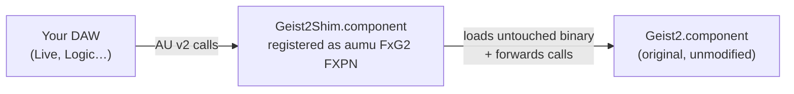

<h1 align="center">Legacy AU Shim</h1>

<p align="center">
  <b>Bring old Audio Unit plug-ins back to life on macOS 27.</b><br>
  FXpansion Geist2, Spitter2 and other classic plug-ins that were never updated: the originals, unmodified.
</p>

<p align="center">
  
  
  
  
</p>

---

## The problem

After upgrading to **macOS 27**, some of your plug-ins silently disappeared:

- **Ableton Live** shows the plug-in as missing, and its log says `Audio Unit v2: Restore 1 failed: <Plugin>`
- **Logic / GarageBand** no longer list it
- `auval -v aumu FxG2 FXPN` says **"didn't find the component"**

The plug-in is still installed, and it worked fine before the upgrade. macOS 27 simply
**stopped recognizing Audio Units that register the old (pre-2011) way**: through a
Carbon `.rsrc` resource file instead of an `AudioComponents` entry in `Info.plist`.
Many classic plug-ins were never updated, so they're now invisible.

## The fix

For each affected plug-in, this project builds a tiny **shim**: a separate AU that
registers the modern way under the **exact same ID and name** as the original.
When your DAW opens it, the shim loads the **genuine plug-in** from where it's
installed and passes every call through to it.



- ✅ **Your old projects open with their plug-in settings restored.** The ID matches, so the DAW can't tell the difference.
- ✅ **Nothing is patched.** The original plug-in, its code signature and its copy protection or licensing are untouched.
- ✅ **No third-party code is included.** You need your own installed (and licensed) copy.
- ✅ **Easy to undo.** It's one extra `.component` file in your user plug-in folder.

---

## Quick start (about 2 minutes)

**You need:** macOS 27, the Xcode command line tools, and Rosetta.

All commands below go in **Terminal** (Applications → Utilities → Terminal). Paste a
command, press Return, and wait for it to finish before the next one.

```sh
xcode-select --install                     # skip if already installed
softwareupdate --install-rosetta           # skip if already installed
```

**1. Get the project**

```sh
git clone https://github.com/gsdan8/legacy-au-shim.git
cd legacy-au-shim
```

**2. See which of your plug-ins are affected.** This lists installed AUs that only
register the old way:

```sh
for d in /Library/Audio/Plug-Ins/Components/*.component; do
  if ! /usr/libexec/PlistBuddy -c "Print :AudioComponents" "$d/Contents/Info.plist" >/dev/null 2>&1 \
     && ls "$d/Contents/Resources" 2>/dev/null | grep -q "\.rsrc$"; then
    basename "$d"
  fi
done
```

Example output (each line is a plug-in that needs a shim; no output means you're not affected):

```text
Geist2.component
Spitter2.component
```

**3. Install a shim.** If the plug-in has a ready-made config in [`configs/`](configs), run:

```sh
./build.sh Geist2 install
```

For any other plug-in, create a config first (see
[Adding another plug-in](#adding-another-plug-in)), then run `./build.sh SomePlugin install`.

**4. Check it.** Use the plug-in's ID from the **ID** column of the
[compatibility table](#compatibility) (or from its config):

```sh
auval -v aumu FxG2 FXPN
#   ...
#   AU VALIDATION SUCCEEDED.
```

**5. Restart your DAW.** In Ableton Live, if the plug-in still doesn't show up, go to
**Settings → Plug-Ins** and **Option-click "Rescan"**.

> 💡 **Back up your projects before opening them the first time**, just in case.

### Uninstall

```sh
./build.sh Geist2 uninstall
```

---

## Compatibility

Tested on macOS 27.0 (26A428) · Apple M1 Max · Ableton Live 12.4.6 (native, Apple Silicon)

| Plug-in | Config | ID (for `auval -v`) | `auval` (Intel + native) | In a DAW |
|---|---|---|:---:|---|
| **FXpansion Geist2** 2.1.2 | `Geist2` | `aumu FxG2 FXPN` | ✅ | ✅ Live: sets restore, editor works |
| **FXpansion Spitter2** 2.1.2 | `Spitter2` | `aufx FXS2 FXPN` | ✅ | not yet tested |

Both are FXpansion plug-ins built with the **Symbiosis** wrapper and were never updated
after 2019. Maintained plug-ins usually aren't affected: their current versions register the
modern way, so only an old installed copy would need a shim (updating it is the better fix).

**Help grow this list.** The plug-ins this fixes are mostly abandoned ones that are hard to
find. If you got another one working (or not), please open an issue or a pull request with
its config, so it can be added to `configs/` for everyone.

Plug-ins built with the **Symbiosis** wrapper or **Apple's AUBase SDK** are the most
likely to work. In general, anything the step 2 command lists is worth a try.

### Adding another plug-in

1. Copy an existing config:
   ```sh
   cp configs/Geist2.plist configs/SomePlugin.plist
   ```
2. Find the plug-in's ID and name in its resource file. The ID is the 4+4+4 characters
   right after `aumu`, `aufx` or `aumf` (here: type `aufx`, subtype `Smpl`, manufacturer `Manu`):
   ```sh
   strings -a "/Library/Audio/Plug-Ins/Components/Some Plugin.component/Contents/Resources/"*.rsrc
   #   aufxSmplManu
   #   Vendor: Some Plugin
   #   SymbiosisEntry
   ```
3. Edit `configs/SomePlugin.plist`:
   - `AudioComponents` → `type`, `subtype`, `manufacturer`, `name` (the "Vendor: Plugin"
     string), and `version`, calculated as major × 65536 + minor × 256 + patch
     (for example 1.0.0 = `65536` and 2.1.2 = `131330`)
   - `LegacyAUBinary` → `/Library/Audio/Plug-Ins/Components/Some Plugin.component/Contents/MacOS/<executable>`
   - `LegacyAUEntry` → the `…Entry` name from step 2 (also listed by `nm -gU <binary>`)
   - `CFBundleExecutable`, `CFBundleName`, `CFBundleIdentifier` → something unique, e.g. `SomePluginShim`
4. Build and check: `./build.sh SomePlugin install`, then `auval -v aufx Smpl Manu`.

---

## Troubleshooting

| Symptom | What to do |
|---|---|
| Plug-in still missing in the DAW | Quit the DAW completely and reopen it. In Live, Option-click **Rescan**. Check that `auval -v …` succeeds. |
| `auval`: *didn't find the component* | The shim isn't installed or the ID is wrong. Run `ls ~/Library/Audio/Plug-Ins/Components` and compare the IDs in `configs/<Name>.plist` with the plug-in's `.rsrc` (see [Adding another plug-in](#adding-another-plug-in)). |
| `auval`: *Class Data fields … do not match* | Saving state needs the other instance mode. Add `<key>LegacyAUStateUsesLegacyInstance</key><true/>` (or `<false/>`) to the config, then rebuild. |
| *Not Authorised* / license error | The plug-in's own licensing (iLok, etc.) isn't active on this Mac. Authorize it the normal way; the shim doesn't touch licensing. |
| "Lost the connection to the Audio Unit" | The plug-in crashed in its host process. Open `~/Library/Logs/DiagnosticReports/AUHostingService*.ips` and open an issue with it. |
| Editor won't open | Open an issue with the host's crash report (if any) and the plug-in name. |

Logs from the shim itself appear in Console.app; search for **`AUShim`**.

---

## FAQ

**Is this a crack?**
No. The shim only fixes how macOS *finds* the plug-in. It loads your installed copy
unmodified, and that copy's own licensing and copy protection run exactly as before. A
plug-in that isn't authorized on your Mac still refuses to run.

**Does it change how the plug-in sounds or behaves?**
No. All audio, presets, the editor and state saving come from the original plug-in's
code. The shim just passes calls through, which adds negligible overhead.

**Will my projects still work if I remove the shim later?**
Yes. The saved state is written by the plug-in itself in its own format.

**Why does it need Rosetta?**
These plug-ins are Intel-only, so the shim is too. Native Apple Silicon DAWs
automatically run Intel AUs in a separate Rosetta process, as they did before macOS 27.

**What happens when Apple removes Rosetta?**
Intel-only plug-ins stop working, with or without this shim. This buys time; it
doesn't make the plug-ins native.

**Can I just edit the plug-in's `Info.plist` instead?**
Don't. It breaks the code signature, and copy-protected plug-ins (Geist2, for
example) abort at load.

---

## How it works (technical)

1. **Registration.** The shim's `Info.plist` has an `AudioComponents` entry copied from
   the legacy `thng` resource (type / subtype / manufacturer / name / version), with
   `factoryFunction = AUShimFactory`.
2. **Loading.** On open, `dlopen`s `LegacyAUBinary` and looks up `LegacyAUEntry`
   (e.g. `SymbiosisEntry`).
3. **Component Manager bridge.** Registers that entry locally with `RegisterComponent`,
   then `OpenAComponent`s a private instance. This still works on macOS 27, even though
   the system no longer *discovers* such components.
4. **Forwarding.** Every AU selector (Initialize, Get/SetProperty, Get/SetParameter,
   ScheduleParameters, Render, Reset, MIDIEvent, listeners and render notifies) is
   marshalled into an LP64 `ComponentParameters` block (`params[0]` = instance, then
   arguments in order) and passed to the entry with the instance storage.
5. **Instance fix-up.** The plug-in reports parameter and property changes using its
   stored instance handle, which AudioToolbox rejects for private Component Manager
   instances. The shim points that field (offset 8 in Symbiosis and AUBase objects;
   the value is verified first) at the host's instance. Symbiosis needs the original
   handle back while saving or restoring state, which the shim handles
   (`LegacyAUStateUsesLegacyInstance`).
6. **Editor.** `kAudioUnitProperty_CocoaUI` returns the shim's own view factory, which
   asks the plug-in for its real factory and hands it the private instance.

### Config reference

`configs/<Name>.plist` becomes the shim bundle's `Info.plist`.

| Key | Meaning |
|---|---|
| `AudioComponents` | The legacy ID, name and version (must match exactly); `factoryFunction` is always `AUShimFactory` |
| `LegacyAUBinary` | Path to the genuine plug-in binary |
| `LegacyAUEntry` | Its Component Manager entry point (from the `dlle` resource) |
| `LegacyAUStateUsesLegacyInstance` | Optional. Which handle the plug-in needs while saving or restoring state. Defaults to `true` for `SymbiosisEntry` and `false` otherwise |
| `CFBundleExecutable` | Also names the shim's Objective-C view class, so keep it unique per shim |

### Project layout

| Path | Purpose |
|---|---|
| [`src/AUShim.mm`](src/AUShim.mm) | The shim: AU v2 plug-in interface → Component Manager bridge |
| [`configs/`](configs) | Ready-made configs |
| [`build.sh`](build.sh) | `./build.sh <Name> [install\|uninstall]` |

### Limitations

- Relies on deprecated Carbon Component Manager APIs that Apple still ships; a future
  macOS release could remove them.
- Not forwarded: SysEx, `AudioUnitProcess`/`ProcessMultiple`, Carbon (non-Cocoa)
  editors. AU v3 plug-ins aren't affected by this problem anyway.

---

## Contributing

Plug-in reports are the most valuable contribution: they grow the compatibility table
and `configs/`. Bug fixes and support for other wrappers are welcome too. Please test
with `auval` in both modes (`auval …` and `arch -x86_64 auval …`) before opening a PR.

## Disclaimer

Not affiliated with Apple or any plug-in vendor. Product names are trademarks of their
respective owners. This project loads software you already own and have installed; it
does not modify, bypass or redistribute it. Use at your own risk, and back up your
projects.

## License

[MIT](LICENSE)
